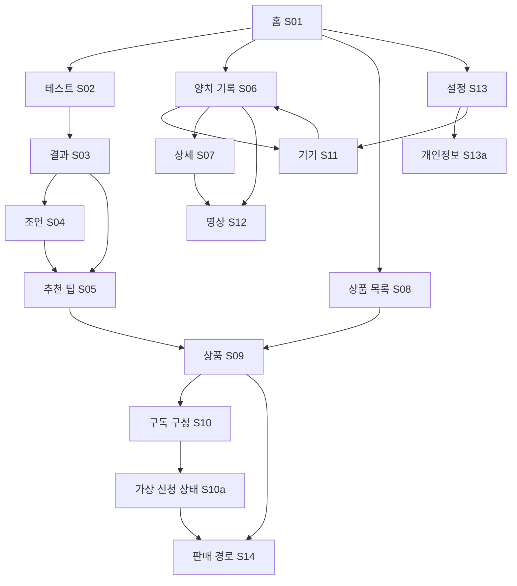

# Phase 0 화면 및 사용자 흐름 분석

검토일: 2026-10-30 (Asia/Seoul). Phase 4까지 로컬 데모 구현. 상품 상세는 사용자 제공 자사몰로 연결하며 구독은 가상 요청, 설정은 현재 탭의 동의/메모리 삭제다. 실제 설문/상태별 제품 적합성/하드웨어·판매 구독 정책은 미확정이다.

## 1. 근거와 읽는 방법

- SSRD: `references/Oneway_SSRD(1).docx`, v1.1, 2026-10-10. §3.2의 RQ/ONRQ가 기능·예외의 기준이다.
- SSAD: `references/ONEWAY_SSAD(2).docx`, v1.0, 2026-10-17. §2.1~2.2, §3.1~3.5, 부록 A/B의 구성·데이터·흐름을 따른다. 도표 6개도 확인했다.
- PDF: `references/Oneway 최종본(2).pdf`, 총 32쪽. 전 페이지 개요 및 핵심 UI 확대 검토. 아래 p.는 **파일의 1부터 시작하는 페이지**다. 인쇄된 슬라이드 번호는 4 작다(예: 파일 p.12 = 인쇄 8, p.20 = 인쇄 16).
- [S]는 원본에서 관찰한 내용, [A]는 구현을 위한 잠정 설계, [F]는 승인 없는 구현 제외다. SSRD·SSAD 자체의 [A]도 실제 제품 확정 사양이 아니다.

## 2. 실제 모바일 UI와 명세 대조

| PDF 위치 | 휴대폰 내부에서 확인한 UI [S] | SSRD·SSAD 대응 | 차이 및 보완 |
|---|---|---|---|
| p.12 (인쇄 8) | ‘구강 타입 테스트’, 회색 선택지와 파란 선택 상태, 중복 선택 안내, ‘해당 없음’, ‘직접 추가하기’, 잇몸 증상 선택. 옆 화면은 결과·ADVICE·CAUSE | RQ-01~03, BH-01~02, OP-01 | 전체 설문·완료 버튼·필수 규칙·산식 없음. 자유 입력 수집 여부는 미정(D-004) |
| p.14 (인쇄 10) | Oneway 헤더, 상품 카드, ‘My oral care’, 구강 기록/맞춤 케어/케어도구/커뮤니티, 8주 변화 배너, Oneway TV | RQ-08, COM-01 | 네 개 아이콘은 **본문 바로가기**이며 하단 탭 근거가 아니다. 커뮤니티·콘텐츠 운영은 SSRD 상세 범위에 없음(D-008) |
| p.20 (인쇄 16) | 검은 단일 양치 결과: 점수 67, 시간 2:02, Coverage 67%, Left 0%, 치열도·원형 지표. 짙은 남색 기간 분석: 2주, 평균 2.1분, 2회/일, 85%, 지난 14일 선 그래프 | RQ-05, COM-03, BH-03, OP-02, OBJ-04 | 숫자는 화면 예시. Left 정의·치열 영역/압력 데이터·그래프 축/집계 규칙 없음. 미수신은 null(D-006) |
| p.21 (인쇄 17) | ‘AI가 추천해주는 교체용 팁 4종’, 서로 다른 팁 이미지. 결과는 시린이/잇몸/치아/입냄새의 선형 수준 표시와 ADVICE/CAUSE 카드 | RQ-02~04, DCOM-01/03, OBJ-02/03/06 | ‘4종’ 제목과 ‘기본 세정 팁 4개’ 하단 문구가 혼재. 팁별 명칭·호환·추천 규칙 불명(D-005) |
| p.22 (인쇄 18) | p.21과 같은 결과 화면, 슬라이드에는 CNN 영상 학습 설명 | RQ-06, BH-04, OP-03 | 파일 선택·동의·업로드·영상 결과 전용 UI는 없음. 차량 등 범주가 보이는 CNN 예시 그림은 구강 모델 구현/검증 증거가 아님(D-002/007) |
| p.13,15 | 소모품 구독·판매 채널의 사업 흐름도. p.13은 팁 3~6개월 교체 문구 | RQ-07/09, BH-05, OP-04 | 앱 내 신청·해지·외부 이동 UI와 실제 판매 URL 없음(D-009/010) |
| p.24~27 | 하드웨어 및 구독의 가격·ASP 기획표. p.25는 3개월 구독 7,900원, p.27은 개별 소모품 7,500원 | RQ-07/09 참고 | 홈 p.14의 42,100원과 제품/시점 동일성 불명. 기획 수치를 현행 판매가로 사용하지 않는다(D-009) |

## 3. 라우트와 화면 목록 [A]

라우트는 웹 설계 제안이다. 결과 ID는 임시 데모 ID만 사용하며 이름·응답·파일명은 URL에 넣지 않는다. 결과·영상·신청은 별개 데이터이며 같은 ID로 혼용하지 않는다. 주요 컴포넌트는 책임 명칭이며 코드가 아니다.

| 화면 ID / 경로 | 목표·주요 컴포넌트 | 요구사항 및 SSAD | 진입 → 다음/복귀 | 주요 상태 | 도입 Phase |
|---|---|---|---|---|---:|
| S01 홈 `/` | 브랜드 헤더, 상품 영역, My oral care 바로가기, 기록 요약, 구독 진입 | RQ-08; COM-01 | 실행/홈 탭 → S02/S06/S08/S09/S11/S13 | 신규·미평가·미연결·요약 있음·요약 로딩/오류 | 2 |
| S02 구강 테스트 `/assessment` | 안내, 문항 그룹, 선택 버튼, 오류 요약, 제출 | RQ-01, ONRQ-02; COM-02, BH-01, DCOM-01, OP-01 | S01/재검사 → S03; 취소→S01 | 미응답·일부/전체 응답·누락·제출 중·실패 | 2 |
| S03 상태 결과 `/assessment/:assessmentId` | 4항목 수준·설명, 결과 출처/시각, 비진단 고지 | RQ-02/03, ONRQ-02, UI-02/04; OBJ-02, OP-01 | S02/S01 → S04/S05/재검사 S02 | 대기·결과 있음·부분 누락·없음·저신뢰·실패 | 2 |
| S04 관리 조언 `/assessment/:assessmentId/advice` | ADVICE/CAUSE 카드, 일반 참고정보, 추천 CTA | RQ-03, ONRQ-02; BH-02, DCOM-01, OBJ-03 | S03 → S05; 뒤로→S03 | 조회 중·유효·없음·저신뢰/오류로 보류 | 2 |
| S05 추천 팁 `/recommendations` | 평가 연계 표시, 팁 4종 후보, 추천 이유·정보 제한 안내 | RQ-04; COM-04, BH-02, DCOM-03, OBJ-06 | S03/S04/S08 → S09; 뒤로→진입 화면 | 로딩·추천 있음·평가 없음·추천 불가·오류 | 2 |
| S06 양치 기록 `/brushing` | 기간 선택, 평균 시간/횟수/커버리지, 이력·그래프, 동기화 시각 | RQ-05, ONRQ-01; COM-03, BH-03, DCOM-02, OP-02 | S01/관리 탭 → S07/S08/S11/S12 | 기록 있음·없음·미연결·동기화 중/실패·과거 기록 | 3 |
| S07 양치 상세 `/brushing/:sessionId` | 시간·점수·커버리지, 가능한 경우 치열도, 데모 출처 | RQ-05, ONRQ-01; OBJ-04 | S06 → S12; 뒤로→S06(기간 유지) | 로딩·유효·일부 지표 null·기록 없음·오류 | 3 |
| S08 상품 목록 `/products` | 상품/팁 구분, 기본 정보, 구독·추천 진입 | RQ-04/07/09; COM-04, DCOM-03/04 | 홈/제품 탭/S05 → S09/S10 | 로딩·목록·빈 목록·정보/호환 미확정·오류 | 4 |
| S09 상품 정보 `/products/:productId` | 이름·유형·확인된 설명, 추천 근거, 미정 정보 안내 | RQ-04/07/09; OBJ-06, BH-05 | S05/S08/S01 → S10/S14; 뒤로→진입 화면 | 유효·정보 미확정·판매 중단·항목 없음·조회 실패 | 4 |
| S10 구독 구성 `/subscription` | 선택 상품·주기·구성 요약, 데모 신청, 해지 경로 안내 | RQ-07, ONRQ-03; DCOM-04, OBJ-07, OP-04 | S08/S09 → S10a; 취소→상품 | 미선택·선택 완료·검증 오류·처리 중·실패 | 4 |
| S10a 신청 상태 `/subscription/status/:intentId` | 가상 요청 내용·외부 확인 유무, 재시도/판매 경로 | RQ-07/09, ONRQ-03; BH-05, OP-04 | S10 → S14/홈; 뒤로→구성 | demo_requested·unconfirmed·실패·요청 없음. 결제/배송 완료 없음 | 4 |
| S11 기기 관리 `/device` | Mock 고지, 연결 상태, 연결/중단/해제/재시도, 최종 동기화 | ONRQ-01, RQ-05; BH-03, DCOM-02/06, OP-02 | S01/S06/설정 → 연결 후 S06 | 미연결→시도→모의 연결/동기화→오류/재시도 | 3 |
| S12 영상 분석 `/video-analysis` | 별도 동의, 파일 선택/해제, 검사, 분석 상태·모의 개선정보 | RQ-06, ONRQ-02/04; BH-04, DCOM-02/05/06, OBJ-05, OP-03 | S06/S07 → 동일 화면의 결과; 뒤로→진입 화면 | 동의 전/거절·파일 없음·미지원/초과·처리 중·모의 결과·저품질/저신뢰·실패 | 3 |
| S13 설정 `/settings` | 개인정보 관리·기기 관리 진입, 데모 범위 설명 | ONRQ-04; COM-05 | 설정 탭 → S13a/S11; 홈→S01 | 기본·동의 요약·요약 로딩/오류 | 4 |
| S13a 개인정보 `/settings/privacy` | 수집 범위/비보관 안내, 동의·철회, 로컬 삭제 대상/확인 | ONRQ-04, RQ-01/05/06; BH-06, DCOM-05, OP-05 | S13 → 삭제 확인 다이얼로그→처리 결과; 취소→유지 | 미동의·동의·철회·삭제 확인/처리 중/완료·부분 실패·모의 권한 거절 | 4 |
| S14 판매 경로 `/sales-channels` | 상품/채널 정보, 외부 이동 고지, URL 유효성/부재 안내 | RQ-09, ONRQ-03; DCOM-06 SalesChannelAdapter, OP-04 | S09/S10a → 검증된 URL만 외부; 복귀→진입 화면 | 주소 없음·채널 중단·이동 가능·이동 실패·주문 미확인 | 4 |
| S15 알 수 없는 경로 `*` | 찾을 수 없음 안내, 홈 이동 | UI-01, RQ-08 지원; COM-01 | 잘못된 URL → 홈 | 경로 없음 | 1 |

S04는 원본의 결과 내 조언을 별도 확대 화면으로도 제공하는 제안이다. S03에서도 핵심 조언을 확인 가능하게 하여 RQ-03 수용 기준을 지킨다. S08/S09의 Phase 2 추천 연결은 미구현 안내만 제공하고 실제 상품·구독 기능은 Phase 4에서 추가한다. Phase 1은 위 기능 화면을 구현하지 않고 라우트의 제목·준비 상태만 표시한다.

## 4. 내비게이션 및 진입 보호 [A]

하단 전역 탭은 **홈 / 양치 관리 / 제품 / 설정** 4개를 제안한다(D-003). 홈 본문의 ‘맞춤 케어’는 설문 또는 기존 결과로, ‘구강 기록’은 S06으로, ‘케어도구’는 S08로 이동한다. 기기 연결은 S01/S06/S13의 보조 진입이다. PDF에 없는 탭을 원안으로 표현하지 않는다.

- 헤더 뒤로가기는 진입 화면으로 복귀한다. 직접 URL 진입으로 이력이 없으면 해당 부모 화면으로 이동한다. 모달은 닫고 원 화면으로 돌아간다.
- 평가 없는 결과/조언 직접 진입은 ‘결과 없음’과 테스트 CTA를 표시한다. 존재하지 않는 세션·상품·신청도 오류/빈 상태를 구별한다.
- SSRD §2.3/PR-03에 따라 첫 진입에서 데모 범위·동의/기기 안내 경로를 제공한다. 구강 응답 입력이나 영상 선택 전 필요한 동의는 해당 흐름에서도 확인한다. 거절 시 수집을 시작하지 않고 일반 정보 화면으로 돌아갈 수 있게 한다. 상세 동의 항목과 기록 범위는 D-011 승인 전 확정하지 않는다.
- 테스트 수정 시 이전 결과·조언·추천의 응답 버전 일치를 검사하고 재평가 전에는 최신 결과로 표시하지 않는다. 미완료 응답은 메모리에서만 유지하는 안이며 새로고침 시 초기화 안내를 제공한다.
- 탭 이동과 파일 선택 취소로 제출/신청이 실행되지 않는다. 제출·동기화·신청 중 중복 실행을 차단한다. 삭제된 결과 URL도 ‘결과 없음’으로 돌아간다.
- 전역 탭은 본문을 가리지 않게 여백과 안전 영역을 둔다. 화면/모달 전환 시 초점을 제목 또는 안내로 옮긴다.

## 5. 사용자 흐름과 예외 회복

| 흐름 | 정상 경로 | 예외 및 회복 | 검증 연결 |
|---|---|---|---|
| OP-01 평가·권고 | 홈→문항 응답→필수 검사→모의 평가→4개 항목/설명→조언→팁 | 누락 항목으로 초점 이동. 실패/저신뢰는 새 결과 생성 없이 재시도. 특정 항목 결측은 평가 불가 | QA RQ-01~04, ONRQ-02, UI-02/04 |
| OP-02 기기·기록 | 관리→Mock 연결→세션 전송→중복 확인→이력/상세 | 시간 초과/권한 거절/전송 중단 구분. 재시도/중단 제공. 과거 기록·최종 갱신 시점 유지, 새 기록으로 위장 금지 | QA RQ-05, ONRQ-01, LOS-04 |
| OP-03 영상 | 별도 동의→파일 검사→가상 처리→모의 개선정보 | 거절 시 수집 없음. 불량·미지원·초과는 분석 시작 금지. 저품질/저신뢰/모델 실패는 결과 보류·파일 변경/재시도. 원본 해제 | QA RQ-06, ONRQ-02/04 |
| OP-04 추천·구독 | 추천/상품→주기·구성 확인→가상 요청→미확인 상태→판매 경로 | 주소/판매처 없으면 이유 안내. 타임아웃·중복 클릭에도 실주문 성공 금지. 외부 이동/복귀는 주문 확인 증거가 아님 | QA RQ-07/09, ONRQ-03 |
| OP-05 개인정보 | 설정→대상 확인→로컬 삭제 확인→실제 제거→완료 표시 | 취소는 보존. 모의 권한 없음/부분 실패는 원인 및 남은 대상을 표시. 서버 재인증/30일 처리와 구분 | QA ONRQ-04, D-011 |

## 6. 디자인 보완과 잠정 토큰

| 구분 | 근거/관찰 | 승인 후 보완안 [A] |
|---|---|---|
| 공통 색 | p.12/14/21의 흰 바탕·파랑 강조·연한 청색 조언 카드 | 기본 강조 `#2F6BF2`, 옅은 배경 `#EDF3FC`, 본문 `#20252D`, 경계 `#E2E7EF`. 이미지에서 추정한 제안값이며 원본 색상 사양 아님 |
| 양치 화면 | p.20의 검정/짙은 남색 배경·파랑 지표·흰 글자 | 양치 분석 영역에 어두운 테마 적용, 공통 내비게이션은 대비 확인. 예시 `#07111F` |
| 글꼴·간격 | 원본 글꼴·정확한 크기·간격 파일 없음 | 한국어 시스템 sans-serif, 본문 16px, 보조 14px, 제목 20~24px, 4/8px 간격 기준, 버튼 높이 최소 44px 제안. 대비·확대 검증 후 조정 |
| 상태 수준 | p.21은 양호/평균/위험 눈금과 점 | 숫자 임계값·백분위·의료 위험 판정 금지. 데모 상대 수준/설명과 출처 표시. 결측은 점 없이 평가 불가 |
| 결과 표현 | 원본 ‘진단 결과’ 및 질환 위험 조언 | SSRD UI-04/LOS-06 우선: ‘구강 상태 참고 결과’, 비진단 고지와 상담 안내. 원문의 질환 단정 문구 그대로 사용하지 않음 |
| 양치 지표 | 치열도·링 그래프·기간 선 그래프 | 범례/단위/데모 표시·대체 텍스트 추가. Left는 의미 확정 전 제외, 범위 데이터 없는 치열도는 미수신 안내 |
| 이미지·아이콘 | 제품·모델 사진, Oneway 로고, 검색·메뉴 아이콘 | 별도 원본 에셋/사용 범위 미제공. PDF에서의 재사용 가능 범위 확인 필요. 검색 기능을 새로 만들지 않고 미제공 이유 안내 또는 제외(D-014) |
| 누락된 UI | 로딩/빈 상태/오류/동의/삭제/주문 미확인 디자인 없음 | 한 가지 상태 안내 컴포넌트로 제목·원인·다음 행동 제공. 동의/삭제는 별도 확인, 임의 민감정보 입력 금지 |

390×844 기준, 모바일 320~430px 전체 폭·기기 프레임 없음, PC max-width 약 390px 중앙 배치를 따른다. 기기 테두리·카메라 구멍·슬라이드 배경과 장식은 앱 UI에 복제하지 않는다. 키보드·세로 스크롤·안전 영역·초점 표시를 검증한다.

## 7. 승인 및 자료 보완 목록

Phase 1 전에 D-003의 화면/탭/라우트와 위 토큰 제안을 검토한다. Phase 2 전에 전체 설문·필수/중복/배타 규칙·평가/추천 데모 규칙·조언 문안을, Phase 3 전에 영상 형식/크기와 지표 의미를, Phase 4 전에 상품·구독 구성/주기·해지 안내·판매 주소·로컬 데이터 정책을 확정해야 한다. 제공되지 않은 자료는 실제 사양으로 채우지 않는다. 커뮤니티·콘텐츠 운영 등 별도 범위는 승인 없이 구현하지 않는다.

## 8. Phase 1 적용 현황

이 절은 Phase 1 당시 이력이며 최신 적용은 다음 Phase 2 절을 따른다.

S01은 바로가기와 범위 안내만 있는 정적 홈 셸, S02~S14 및 S10a/S13a는 제목·해당 단계 준비 안내, S15는 경로 없음/홈 복귀로 구현했다. `src/routes/screens.ts`가 경로 정의, `src/components/AppShell.tsx`가 공통 내비게이션·초점·이력 복귀를 담당한다. 파라미터 ID는 경로 매칭에만 사용하며 결과/기록/상품/주문 데이터로 생성하거나 해석하지 않는다.

홈의 실제 상품 배너·기록 요약·커뮤니티/TV는 추가하지 않았다. 원본 에셋 대신 텍스트 워드마크·Lucide 아이콘과 준비 상태를 사용한다. 상세 빈 화면·실패·동의/삭제 등의 업무 상태는 미구현이며 다음 단계 검증 대상이다. `StateNotice`는 준비/빈 상태/오류의 공통 표현 책임만 제공한다.

모바일 320/360/390/430px 및 PC 1280px에서 셸·탭바 폭과 가로 넘침을 검사했다. 일반 세로 스크롤바를 제외한 가용 폭을 기준으로 모바일 전체 폭/PC 390px 중앙 배치이며 기기 프레임은 없다. 실제 기기의 노치·키보드는 미검증이다. 증거와 판정은 TEST_RESULTS의 Phase 1 기록을 참조한다.

## 9. Phase 2 적용 현황

S01은 미평가/처리 중/오류 보류/유효 결과 요약·이어보기, S02는 가상 설문·체험 확인·필수 검사·제출/재시도, S03은 4개 응답 수준/결측·조언, S04는 상세 조언/분류 근거, S05는 후보 분류·4종 개념·대체 안내로 구현했다. 실제 상품 정보 연결은 S09 준비 화면까지만 제공한다.

사용자가 실제 건강정보를 입력하도록 요청하지 않는다. 가상 인물 고정 선택지만 제공하며 입력은 메모리에 한정한다. 명세는 PHASE2_DEMO_SPEC, 코드 대응은 REQUIREMENTS_TRACEABILITY의 Phase 2 표를 따른다.

결과 ID/응답 revision이 일치할 때만 결과/조언을 표시한다. 수정·체험 확인 해제·새로고침 후 이전 경로는 결과 없음이다. 저신뢰/실패는 결과 생성 없이 보류, 일부 미수신은 해당 항목만 null, 조언 실패 시 평가 항목 유지·후보 추천 보류다. 응답이 전부 없음/알 수 없음이면 일반 팁 개념만 안내한다. S01~S05 5화면×5개 크기 및 정상/예외 61개 브라우저 검사는 TEST_RESULTS에 연결했다.

## 10. Phase 3 적용 현황

S06은 7/14/30일 예시 기록/평균·추이·상세 진입, S07은 한 번의 점수·시간·커버리지/영역 미수신, S11은 모의 연결/동기화·상태/취소/오류 회복, S12는 별도 동의·파일 검사·모의 결과/보류/재시도로 구현했다. 모든 기기/영상 화면에 Mock·비진단 고지를 제공한다. S01도 기기 상태/예시 기록 수·마지막 정상 동기화 요약을 표시한다.

S07→S12는 `/video-analysis?session=<demo-id>`로 선택적 문맥을 전달한다. 세션이 없으면 독립 영상으로 안내하며, 영상 상태는 화면 이탈·세션 문맥 변경·철회 시 정리한다. 영상은 기기 기록에 합치지 않는다. 기기 해제/전송 실패는 과거 기록을 지우지 않으며, 다시 수신한 것처럼 표시하지 않는다.

파일 검사/집계/재시도 수치와 데이터 경계는 PHASE3_DEMO_SPEC의 [A]다. 실제 영상 품질·내용 분석이나 하드웨어 호환 구현이 아니다. Phase 3 브라우저 81건(반응형 30건), 단위 누적 21건은 TEST_RESULTS와 추적표에 연결했다.

## 11. Phase 4 적용 현황

- S05 데모 분류 → 별도 자사몰 상품 목록. 후보 A~D와 실제품 대응은 미확정으로 유지한다.
- S08 `/products` → S09 `/products/tip-532|518|364|363` → 자사몰 새 탭. 모델/상품명·외부 최신 조건 확인. 없는 ID는 목록 복귀 안내.
- S09 → S10 `/subscription?product=tip-…` 상품 전달 → 상품/가상 3·6개월/체험 확인 → 로컬 가상 신청 → S10a `/subscription/status/:intentId`. 가상 생성/미확인/실패/중단·재시도/철회, 새로고침·삭제/구성 변경 시 이전 ID 없음. 외부 구매 완료를 표시하지 않는다.
- S14 `/sales-channels`: 공식몰 홈, 접속 실패 시 네트워크/재열기·상품 복귀 안내. 주소 없음/불가는 개발 시나리오로 확인.
- S13 `/settings` → S13a `/settings/privacy`: 설문·구독 확인 철회, 영상 이탈 초기화 설명, 실제 삭제 대상/확인/취소 → 각 메모리 reset → 대상별 삭제/부분 실패·재시도. 판매처/다른 탭/서버는 삭제 대상 밖.
- S01 홈: 구독 처리 중/가상 상태/철회 상태 진입, 삭제 후 미평가/미연결/기록 없음. 요청 완료로 이탈한 화면을 강제로 바꾸지 않는다.

기존 표의 Phase 4 준비 문구는 당시 계획이다. 실제 컴포넌트는 ProductsPage/ProductDetailPage/SalesChannelsPage, SubscriptionPage/SubscriptionStatusPage, SettingsPage/PrivacyPage, ProductCard/ShopLink다. 정상/빈/오류·확인 화면은 기존 밝은 테마 토큰을 적용한다. 모바일 지정 크기 재검증은 도구 제약으로 Not tested이며 TEST_RESULTS 참조.
