# ONEWAY Re-engineering Before–After 보고서

> 참고 서비스: Philips Sonicare 앱 · 리버스 엔지니어링 근거: [`sonicare-analysis.md`](sonicare-analysis.md)
> Before: 커밋 `5bb2f6b`(Phase 5 완료) · After: 이번 Re-engineering 변경(C1~C5)
> 캡처: 390px 모바일 폭, 전체 페이지(`img/before`, `img/after`), Sonicare 실기기 캡처(`img/sonicare`)
> 원칙: Sonicare를 복제하지 않는다. 좋은 *구조·패턴*만 가져와 ONEWAY의 강점(투명한 데모 표시, 설문 기반 맞춤 케어, 영상 분석)과 결합한다.

---

## 0. 요약

| # | 개선 항목 | 가져온 아이디어 (Sonicare) | 근거 유형 | ONEWAY식 진화 | 요구사항 |
|---|---|---|---|---|---|
| C1 | 홈 "오늘의 관리" 상태 카드 | 규칙 기반 카드형 홈, 기기 카드의 연결/연결됨/문제해결 전환 | **정적 분석 추정** — 홈 레이아웃(카드 목록 단일 구성)·카드 규칙 클래스·기기 카드 화면 패키지로 구조 확인. 실제 카드 종류·순서는 미확인 | 우선순위 규칙을 코드로 공개·테스트, 카드마다 "데모 데이터 기준" 표시 | RQ-08 |
| C2 | 양치 연속 기록(스트릭) | Streaks, 중단 시 회복 문구 | **정적 분석 추정** — 연속 기록 알림 문구(증가/끊김/재시작)와 계산 클래스 메서드명으로 기능 확인. 계산 규칙·화면은 미확인 | KST 자정 기준 계산, 기록이 없으면 "0일"로 위장하지 않고 카드 자체를 숨김 | RQ-05 |
| C3 | 양치 결과 등급 라벨 | GREAT/GOOD/FAIR 3단계 판정 + 한 줄 요약 | **정적 분석 추정** — 3단계 등급 enum과 결과 화면 레이아웃 구성 요소(상태·요약 설명)로 확인. 실제 표시 방식은 미확인 | 점수 미수신 시 4번째 등급 "평가 불가", 구간은 데모 가정으로 화면에 명시 | RQ-02, RQ-05 |
| C4 | 교체용 팁 사용 주기 게이지 | 칫솔모 휠·빨간 구역, "왜 교체해야 하나요?", 교체 알림→재주문 | **정적 분석(앱 내장 설명 문구)** — 휠 읽는 법·빨간 구역 교체 기준을 앱 자체 문구로 확인. 화면 모양은 미확인 | 원웨이 팁에 맞춘 원형 게이지 → 구독 구성 연결, 주기 90일은 데모 가정 | RQ-04, RQ-07 |
| C5 | 연결 전 안내 + 문제 해결 가이드 | 권한 사전 안내, troubleshoot 화면, "원인+행동" 오류 문구 | **실기기 관찰** — 권한 사전 안내 화면 직접 캡처(§1) + 연결 오류 문구 정적 분석 | 모의 연결임을 밝히면서 실패 원인별(권한/시간초과/연결불가) 점검 목록 제공 | ONRQ-01, ONRQ-04 |

> **근거 유형 안내**: 실제 칫솔이 없어 페어링 이후 화면은 볼 수 없었다. C1~C4는 화면을 따라 만든 것이 아니라, 디컴파일한 코드·리소스로 소닉케어가 *어떤 기능을 어떤 구조로* 제공하는지 파악한 뒤 화면은 ONEWAY 스타일로 새로 설계했다. 실행 화면 없이 코드와 리소스로 기능을 재구성한 것 자체가 이번 리버스 엔지니어링의 핵심 과정이며, 화면 복제를 하지 않았다는 근거이기도 하다.

---

## 1. 참고 서비스 — Sonicare UI/UX

| 웰컴 | 칫솔 연결 진입 | 권한 사전 안내 |
|---|---|---|
|  | 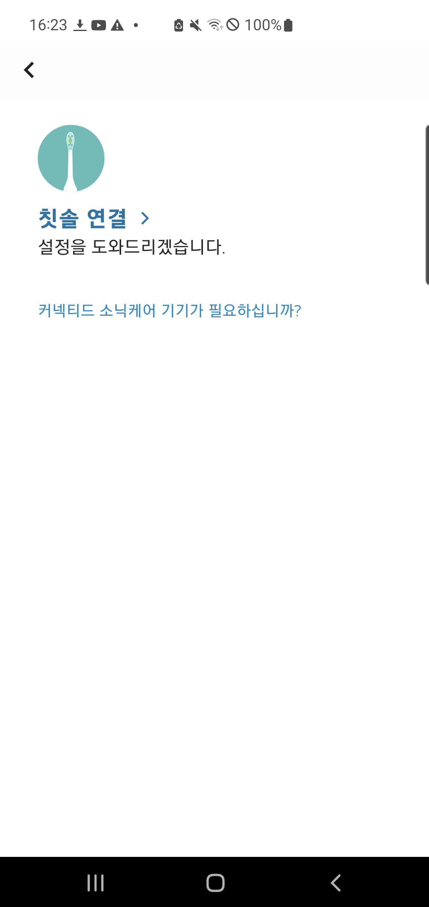 | 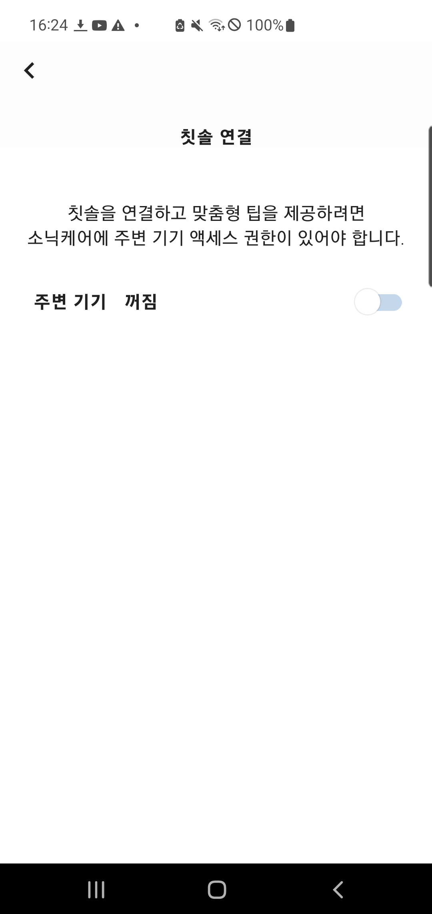 |
| 전체 화면 영상 + 주 행동 1개 | 기기 미보유자용 구매 경로를 첫 화면에 배치 | 시스템 권한 요청 **전에** 이유를 먼저 설명 |

> 출처: Philips Sonicare Android 앱(본인 기기 실행 화면, 2026-11-15). 비교·학습 목적의 최소 인용.
> 실제 칫솔이 없어 페어링 이후 화면(홈·결과·칫솔모)은 캡처하지 못했고, 디컴파일한 레이아웃·문자열로 구조를 분석했다(`sonicare-analysis.md` §4).

---

## 2. Before — 기존 ONEWAY

### 2.1 UI/UX
| 화면 | 상태 | 한계 |
|---|---|---|
| 홈 | 히어로 + 빠른 링크 3개 + 상태 요약 텍스트 박스 | 기기·기록 상태가 **회색 박스 안 작은 문장**으로만 표시되어 지금 할 일이 눈에 띄지 않음 |
| 양치 관리 | 지표 3개 + 차트 + 기록 목록 | 숫자 나열 위주, **습관 동기 부여 요소 없음** |
| 양치 상세 | 점수 원형 그래프 + 시간·커버리지 + 6구역 | 67점이 **좋은지 나쁜지 해석 없음** |
| 추천 팁 | 후보 A~D + 상품 목록 | **언제 교체해야 하는지** 맥락이 없어 구독 동기가 약함 |
| 기기 관리 | "시연용 기기 연결" 버튼 → 실패 문구 + "정상 시나리오로 다시 연결" | 연결 전 설명 없음, 실패 시 **해결 방법 안내 없음** |

### 2.2 기능
- RQ-01~09 전 기능 모의 구현(설문→결과→조언→추천, 기기 연결·동기화, 영상 모의 분석, 가상 구독, 판매 경로).
- 예외: 연결 실패/시간 초과/권한 거절, 동기화 재시도 3회, 저신뢰 분석, 미확인 주문, 부분 삭제 실패 구분.

### 2.3 비기능
- React + TypeScript + Vite, 390px 기준 모바일 우선(320~430 대응). 단위 테스트 31건.
- 데이터는 탭 메모리에만 보관, 개인정보·영상 로컬 저장 없음. 모든 모의 기능에 "가상/데모" 표시.
- 번들(gzip): JS 104.09KB, CSS 6.23KB.

---

## 3. After — 화면별 Before / After

### C1. 홈 "오늘의 관리" 상태 카드
| Before | After (첫 방문) | After (연결·팁 교체 시기) |
|---|---|---|
| 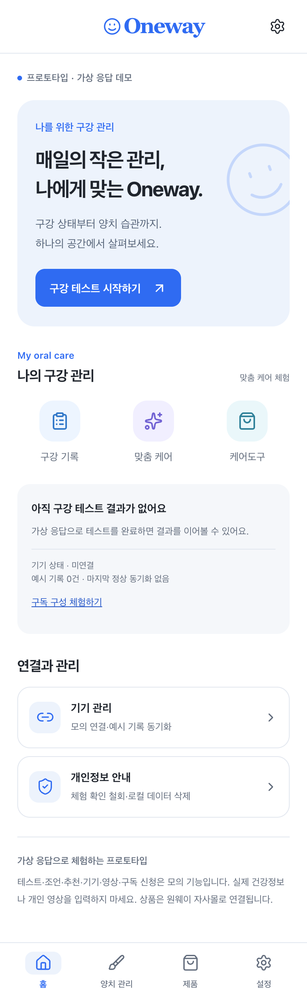 | 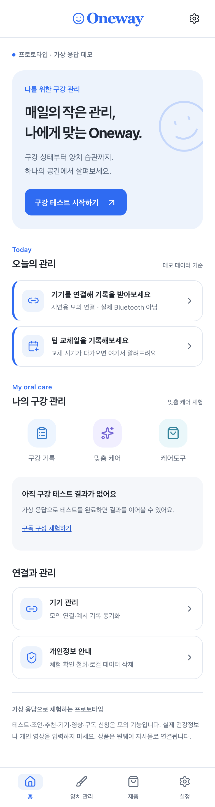 | 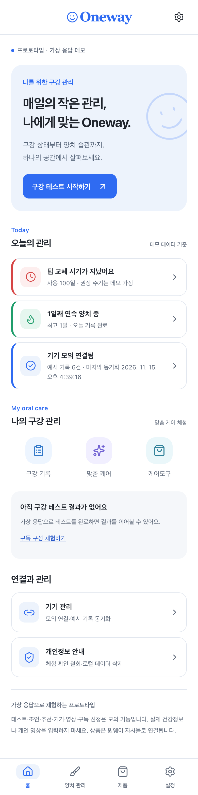 |

- **변경**: 히어로 아래에 카드를 최대 3장 보여준다. 순서는 `src/domain/home.ts` 규칙을 따른다: 기기 오류(0) → 팁 교체 지남(1) → 팁 교체 임박(2) → 연속 기록(3) → 기기 상태(4) → 팁 교체일 미입력(5).
- 카드 색상: 빨강=조치 필요, 주황=곧 필요, 초록=잘하고 있음, 파랑=안내. 카드를 누르면 해당 화면으로 이동한다.
- 기존 상태 요약 박스에서 기기 문장은 카드로 옮기고, 설문·구독 상태만 남겼다.

### C2. 양치 연속 기록 · C3. 등급 라벨 (목록)
| Before | After |
|---|---|
| 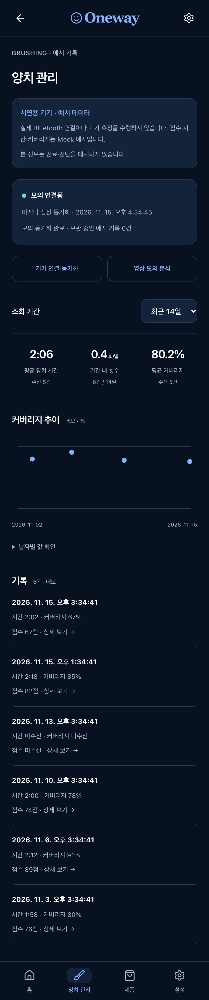 | 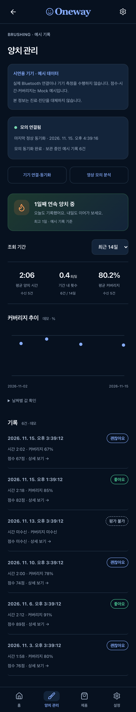 |

- **연속 기록 카드**: "1일째 연속 양치 중 / 최고 1일 · 예시 기록 기준". 끊긴 경우 "괜찮아요. 오늘 한 번 닦으면 다시 1일부터 시작해요"처럼 비난하지 않는 문구로 안내한다.
- **기록 목록**: 각 기록 오른쪽에 등급 칩(좋아요/괜찮아요/보완 필요/평가 불가)을 붙였다. 점수를 받지 못한 기록은 점선 칩 "평가 불가"로 표시한다.

### C3. 등급 라벨 (상세)
| Before | After |
|---|---|
| 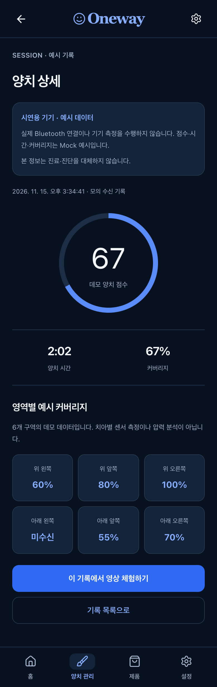 | 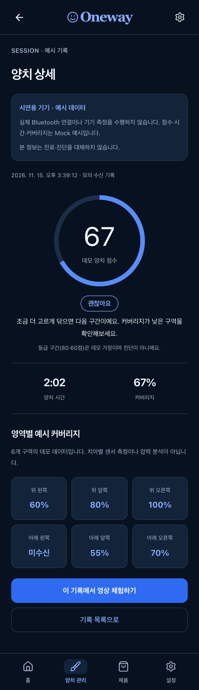 |

- 점수 아래에 등급 칩, 한 줄 해석, "등급 구간(80·60점)은 데모 가정이며 진단이 아니에요" 고지를 추가했다.

### C4. 팁 사용 주기 게이지
| Before | After (미입력) | After (교체 임박) | After (교체 지남) |
|---|---|---|---|
| 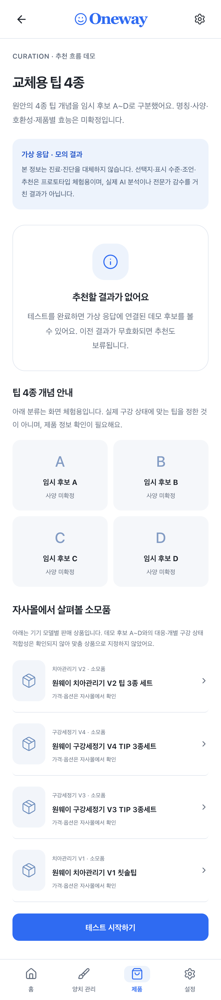 | 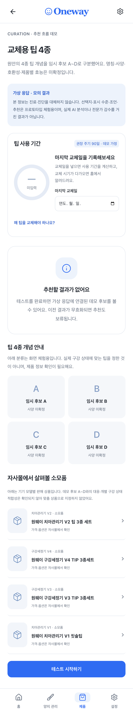 | 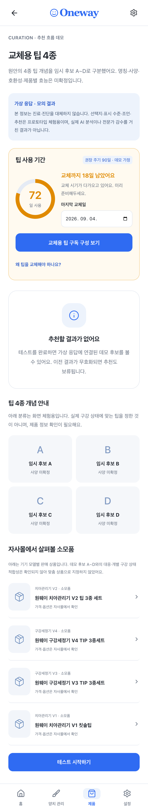 | 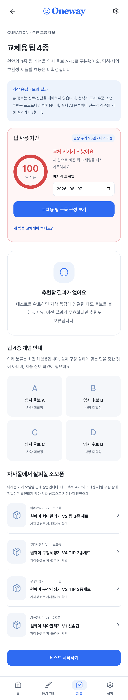 |

- 마지막 교체일을 입력하면 사용 일수를 원형 게이지로 보여준다. 70% 미만은 파랑, 70~99%는 주황, 100% 이상은 빨강이다.
- 교체 임박·지남 상태에서는 "교체용 팁 구독 구성 보기" 버튼이 나타난다(교체 시점 → 구독으로 연결).
- 접이식 "왜 팁을 교체해야 하나요?"에서 교체 이유를 설명하고, 90일이 데모 가정임을 밝힌다.
- 미래 날짜나 잘못된 날짜는 계산하지 않고 "올바른 교체일이 아니에요"로 안내한다. 교체일은 메모리에만 두며, 설정의 로컬 데이터 삭제 대상에 포함했다.

### C5. 연결 전 안내 + 문제 해결 가이드
| Before (연결 전) | After (연결 전) | Before (연결 실패) | After (연결 실패) |
|---|---|---|---|
| 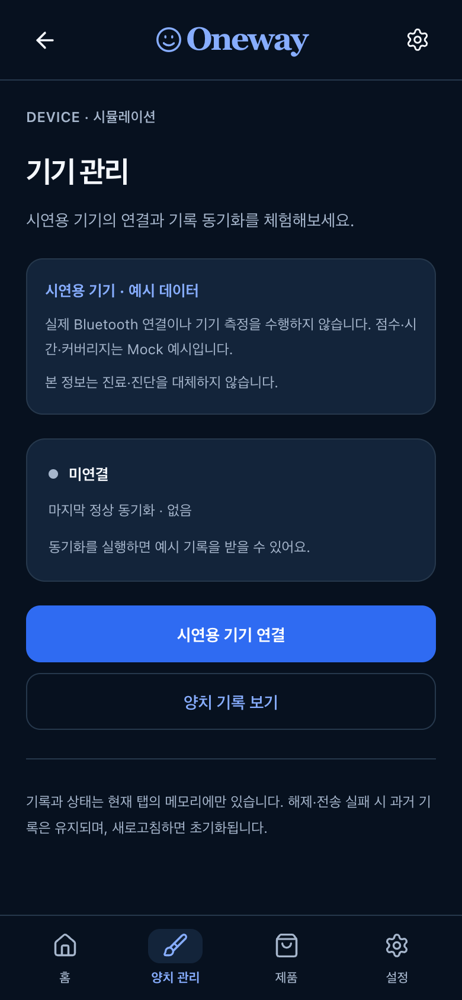 | 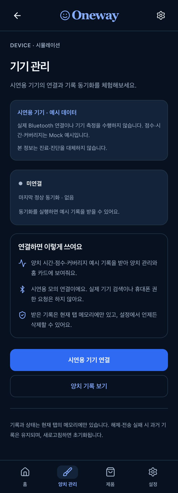 | 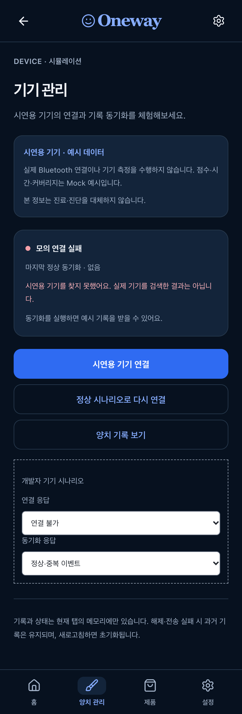 | 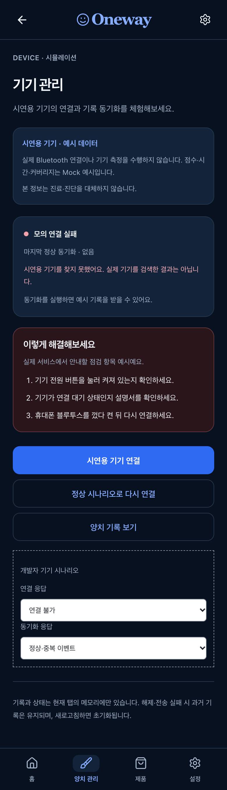 |

- **연결 전**: "연결하면 이렇게 쓰여요" 3항목 — 무엇을 받는지 / 모의 연결이라 실제 권한을 요청하지 않음 / 메모리에만 보관하고 삭제 가능.
- **연결 실패**: 실패 원인(권한 거절·시간 초과·연결 불가)에 따라 다른 점검 목록 3단계를 다시 연결 버튼 바로 위에 보여준다. 실패 원인은 서비스 상태(`connectionErrorKind`)로 보관한다.
- 연결 실패 캡처의 점선 박스는 시연용 개발자 시나리오 패널(`?demoDebug=1`, 개발 모드 전용)이다.

---

## 4. 비기능 변화 (측정값)

| 항목 | Before | After | 비고 |
|---|---|---|---|
| 신규 의존성 | — | **0개** | 게이지·칩은 CSS `conic-gradient`, 아이콘은 기존 Lucide |
| JS 번들 (gzip) | 104.09KB | 107.41KB | +3.3KB |
| CSS 번들 (gzip) | 6.23KB | 7.10KB | +0.9KB |
| 단위 테스트 | 31건 | **36건 전부 통과** | 연속 기록·등급·팁 주기·홈 카드 규칙·연결 실패 유형 |
| 타입 검사 | Pass | Pass | `tsc --noEmit` |
| 로직 위치 | — | 도메인 순수 함수 | `domain/brushing.ts`(연속 기록·등급), `domain/tipCycle.ts`, `domain/home.ts` — UI와 분리해 테스트 가능 |
| 시간대 | KST | KST | 연속 기록·팁 사용일 모두 KST 자정 기준, 경계 테스트 포함 |
| 개인정보 | 메모리 전용 | 메모리 전용 | 팁 교체일도 메모리 전용, 로컬 삭제 대상에 추가 |
| 접근성 | `role=status/alert` | 유지 + 게이지 `role=img` 대체 텍스트, 상태 문구 `role=status` | |
| 오류 문구 | 상태 설명 위주 | "원인 + 다음 행동" | 연결 실패 점검 목록 |

### 검증하지 못한 것 (정직하게 기록)
- 320/360/430px 폭과 키보드 탐색은 이번 변경분에 대해 다시 검사하지 않았다(390px 캡처만).
- 실제 사용자 반응(연속 기록이 실제로 동기 부여가 되는지)은 측정하지 않았다.
- 팁 교체 주기 90일과 등급 구간 80·60점은 근거 자료가 없는 데모 가정이다(`DECISIONS.md` D-RE-01/02).

---

## 5. Lessons Learned

> 과제 조건: **팀원 각자 3가지 이상**. 각 팀원이 직접 작성한다.

### 팀원 1
1.
2.
3.

### 팀원 2
1.
2.
3.

### 팀원 3
1.
2.
3.

### 팀원 4
1.
2.
3.

---

## 부록 — 변경 파일
| 구분 | 파일 |
|---|---|
| 도메인 | `src/domain/brushing.ts`(연속 기록·등급), `src/domain/tipCycle.ts`(신규), `src/domain/home.ts`(신규) |
| 서비스 | `src/services/brushingService.ts`(연결 실패 유형·팁 교체일), `src/services/privacyService.ts`(삭제 대상 문구) |
| 컴포넌트 | `src/components/HomeCards.tsx`, `BrushingInsights.tsx`, `TipCycleCard.tsx`(모두 신규) |
| 화면 | `HomePage.tsx`, `BrushingPage.tsx`, `BrushingDetailPage.tsx`, `RecommendationsPage.tsx`, `DevicePage.tsx` |
| 스타일 | `src/styles/app.css`(RE-C1~C5 블록) |
| 테스트 | `tests/reengineering.test.ts`(신규, 5건) |
