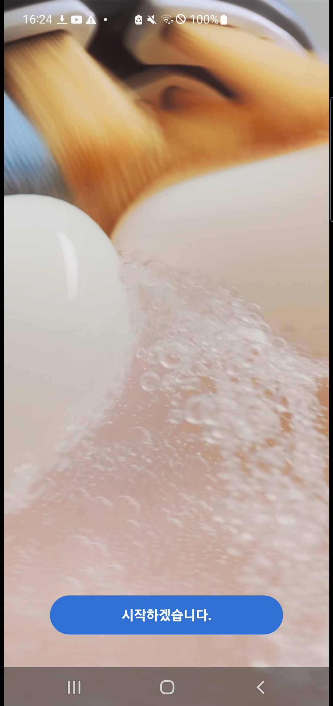
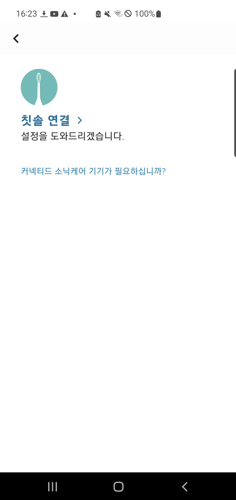
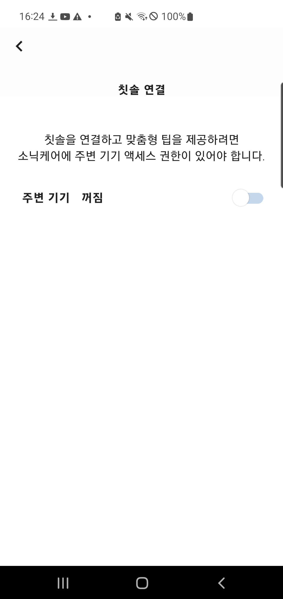

# Philips Sonicare 앱 리버스 엔지니어링 분석

> 과제: Reverse-engineering → Re-engineering (1단계 산출물)
> 분석일: 2026-11-15 · 분석 도구: REA(Reverse Engineer Anything) MCP + JADX · 분석자: 담당 1
> 목적: ONEWAY의 UI/UX·기능·비기능 개선 아이디어 도출. **코드·이미지·문구·폰트를 ONEWAY에 복제하지 않는다.**

---

## 1. 분석 대상과 방법

| 항목 | 내용 |
|---|---|
| 대상 앱 | Philips Sonicare (패키지 `com.philips.cdp.ohc.tuscany`) |
| 확보 경로 | 본인 소유 Android 기기(Galaxy S10 5G, SM-G977N)에 설치된 앱을 `adb pull`로 추출 — 비공식 배포처 미사용 |
| 파일 | `base.apk`(약 87MB), `split_config.arm64_v8a.apk`, `split_config.xxhdpi.apk` |
| 정적 분석 | JADX 디컴파일 → 패키지 구조, 리소스(한국어 문자열·색상·폰트·레이아웃) 분석 |
| 동적 분석 | REA `list_adb_devices` / `start_adb_app` / `capture_adb_screen`으로 실제 앱 실행·화면 캡처 |
| 산출물 보관 | APK·디컴파일 결과는 레포 밖 `~/re-work/sonicare/`에 보관(커밋 금지). 실행 캡처 3장만 `img/sonicare/`에 출처 표기 후 수록 |

### 분석 한계 (정직하게 기록)
- **실제 칫솔이 없어** 페어링 이후 화면(홈 대시보드, 양치 결과, 칫솔모 화면)은 실기기 캡처 불가. 해당 부분은 **디컴파일한 레이아웃·문자열·클래스 구조로 추정**했다. 추정은 `[추정]`으로 표시.
- 주변 기기(블루투스) 권한은 사용자 기기 설정 변경이라 허용하지 않았다.
- 코드가 R8로 난독화되어(`a.java`, `b0.java` 등) 세부 알고리즘(예: 칫솔모 마모 계산식)은 확인하지 못했다.
- 일부 기능(Amazon 스마트 재주문 등)은 국가별 제공 여부가 다르며, 한국에서 실제로 동작하는지는 확인하지 않았다.

---

## 2. 앱 구조 (패키지 기준 기능 지도)

`sources/com/philips/cdp/ohc/tuscany/` 하위 기능 패키지:

| 영역 | 패키지 | 의미 |
|---|---|---|
| 진입·온보딩 | `splash_screen`, `onboarding`, `welcomeinsurance`, `userregistration`, `gdpr` | 스플래시 → 동영상 웰컴 → 칫솔 연결 → 동의 |
| 기기 연결 | `ble`, `blehome`, `handle_controls`, `upgrade` | BLE 연결, 칫솔 설정, 펌웨어 업데이트 |
| 홈 | `home` (`home_buckets_ui`, `rules_use_case`, `dynamic_streaming`, `product_card`) | **규칙 기반 카드형 홈** |
| 양치 | `brushing`, `regular_use`, `mouthgl`, `views/mouthmap` | 실시간 양치 가이드, 3D/2D 구강 맵 |
| 인사이트 | `insights`, `assess_and_improve` | 세션 평가(GREAT/GOOD/FAIR), 개선 팁 |
| 습관 | `streaks`, `dental_diary`, `local_notifications` | 연속 기록, 치아 관리 일지, 리마인더 |
| 칫솔모 | `brushhead`, `bhm`(Brush Head Monitor), `amazondart` | 칫솔모 수명 추적 + 스마트 재주문 |
| 콘텐츠 | `contentful`, `content_ful_expanded_view` | 서버(CMS)에서 내려주는 팁·카드 |
| 기타 | `profile`, `menu`, `about`, `payers`/`deltadental`(보험 연계) | 계정·설정 |

화면 구성: `activity_home.xml` → `fragment_home.xml`은 **`RecyclerView`(카드 목록) + `ComposeView` + 로딩 `ProgressBar`** 단 세 요소. 홈 내용은 전부 카드로 동적 구성된다.

---

## 3. 실제 화면 관찰 (동적 분석)

| # | 화면 | 관찰 내용 | 캡처 |
|---|---|---|---|
| 1 | 웰컴 | 전체 화면 제품 영상 배경 + 하단 고정 알약형 CTA 1개("시작하겠습니다.") |  |
| 2 | 칫솔 연결 진입 | 원형 일러스트 + 굵은 링크형 제목 "칫솔 연결 >" + 한 줄 안내. 하단에 "커넥티드 소닉케어 기기가 필요하십니까?" 보조 링크(→ 외부 웹 구매 페이지, Chrome으로 이동 확인) |  |
| 3 | 권한 사전 안내 | 시스템 권한 창 **이전에** "칫솔을 연결하고 맞춤형 팁을 제공하려면 … 주변 기기 액세스 권한이 있어야 합니다" 설명 + 토글. 활동은 `OnBoardingActivity` |  |

관찰 포인트
- **한 화면 한 행동**: 각 온보딩 화면에 주 행동이 하나뿐. 텍스트 2줄 이내.
- **권한 요청 전에 이유부터 설명**(pre-permission pattern). 거절 시 안내 문자열도 별도 존재(`HOME_NEARBY_ACCESS_DENIED_NOTIFICATION_TITLE`).
- **기기 미보유 사용자 이탈 경로**를 첫 화면에 둠 → 구매 채널로 연결.

---

## 4. 핵심 기능 흐름 (정적 분석)

### 4.1 칫솔모 수명 관리 + 재주문 (ONEWAY RQ-04, RQ-07과 직접 대응)
- `brushhead/BrushHeadManager`, `bhm/*`: 칫솔모 단위로 사용 이력을 추적.
- 문자열 근거: "실제 칫솔모 사용 기간을 추적하여 교체 시기를 알려주기 때문에…"(`BRUS_BH_REPLACE_DESC`), "칫솔모 교체 시간!"(`DART_BRUSH_HEAD_TIME_NOTIFICATION`).
- **시각화 — 칫솔모 휠**(`BRUSH_HEAD_HOW_TO_READ_DESC`): 원형 휠의 각 뾰족한 부위 = 양치 세션 1회, 길이 = 적용 압력. 휠이 **빨간 구역**에 도달하면 교체(`DART_BHM_EFFECTIVE_SESSION_MSG`).
- **교체 이유 설명 화면**: "왜 칫솔모를 교체해야 하나요?"(`BHM_TITLE_ONE`) → 교육 후 행동 유도.
- **재주문 상태 3단계**: `SUBSCRIPTION_ACTIVE`(구독 사용 중) / `SUBSCRIPTION_INACTIVE`(사용 안함) / `SUBSCRIPTION_INCOMPLETE`(**구독 미완료**). 외부(Amazon) 확인 전 단계를 별도 상태로 표시.
- 재주문 동의 철회 경로 존재(`DART_CONSENT_REVOKE_TITLE`), "내 칫솔모 화면에서 칫솔모 수와 재주문 설정을 관리"(`DART_HOW_IT_WORKS_NOTE_2`).
- 교체 알림 → 재주문 CTA가 **같은 알림 안에서** 연결("칫솔모 교체 시기입니다. 스마트 재주문으로 …").

### 4.2 양치 결과 해석 (RQ-02, RQ-05)
- `assess_and_improve/BehaviourPattern` enum: **`GREAT`, `GOOD`, `FAIR`** — 숫자 점수보다 **3단계 등급**으로 결과를 요약.
- `fragment_brushing_summary_fragment_lite.xml`: 구강 맵(`LiveBrushingMouthMapWrapperView`) + 제목 + **상태(status)** + **요약 설명(summary_detail)** + 완료 버튼. 즉 결과 화면 = *시각화 → 한 줄 판정 → 설명 → 다음 행동*.
- 문지르기·압력 피드백: "너무 세게 문지르면, 가볍고 부드러운 진동으로 알려줍니다."(`HANDLE_SETTINGS_SCRUBBING_FEEDBACK_DESCRIPTION`) — 문제 행동을 **비난 없이** 표현.

### 4.3 습관 형성 — 연속 기록(Streaks)
- `streaks/StreakHelperImpl`: `evaluateStreak`, `evaluateMilestone`, `evaluateBrushingFrequencyStreakRule` — 하루 양치 횟수 규칙으로 연속 일수·마일스톤 계산.
- 문구 설계: 증가("좋습니다! %d일째 …"), 중단("저런, 양치 연속 기록이 깨졌어요"), 재시작 3종 + **회복 경로**("치아 관리 일지에서 연속 기록을 회복하세요"). 실패해도 다시 시작할 길을 준다.

### 4.4 규칙 기반 카드형 홈 (RQ-08)
- `home/rules_use_case/Bucket3RulesUseCase`, `Bucket4UseCaseModel`, `insights/brushing/InsightRulesManager`: 최근 세션(`latestTwoSessions`)을 보고 **조건에 맞는 카드만** 홈에 노출(버킷별 우선순위).
- `home/product_card/screens/{connect, connected_devices, troubleshoot}`: 홈의 기기 카드가 상태에 따라 **연결하기 / 연결된 기기 / 문제 해결**로 바뀜.
- `HomeWhatsNewUI` + `observeCardDismissedEvent`: 새 기능 카드는 사용자가 닫을 수 있음.

### 4.5 기기 연결·동기화 예외 처리 (ONRQ-01)
상태별 문구가 세분화되어 있다.

| 상태 | 문자열 키 | 사용자 문구 요지 |
|---|---|---|
| 동기화 중 | `DATA_SYNC_CONNECTED_DESC` | 칫솔이 연결되어 최신 기록 동기화 중 |
| 동기화 안내 | `DATA_SYNC_INFO_TITLE` | "칫솔을 가까이 두어 동기화하세요" (해결 행동 제시) |
| 동기화 실패 | `DATA_SYNC_FAILED` | 데이터 동기화 실패 |
| 연결 불가 | `BLE_UNABLE_TO_CONNECT_YOUR_HANDLE` | 칫솔에 연결할 수 없습니다 |
| 연결 끊김 | `DATA_ACT_HANDLE_DISCONNECTION_TITLE` | 제품 연결 끊김 |
| 권한 거부 | `HOME_NEARBY_ACCESS_DENIED_NOTIFICATION_TITLE` | 연결할 수 없음 |
| 오프라인 | `NO_INTERNET_DESCRIPTION` | 오프라인인 것 같습니다. 인터넷 설정 확인 |
| 펌웨어 실패 | `FWUP_FAIL` | 실패 + "아래를 눌러 다시 시도하세요" |

→ 실패 메시지마다 **원인 + 다음 행동**을 붙이는 패턴. 홈 기기 카드의 `troubleshoot` 화면과 연결.

### 4.6 개인정보·동의 (ONRQ-04)
- `gdpr` 패키지, 양치 지침 동의(`BRUSHING_GUIDANCE_CONSENT_DESC`), 마케팅 동의를 **분리**.
- 삭제 확인 문구가 **잃게 되는 데이터 범위를 명시**: "이 칫솔모와 관련된 모든 데이터를 잃게 됩니다. 정말 삭제하시겠습니까?"(`BHM_ALERT_DELETE_BRUSH`).

---

## 5. 디자인 요소

| 항목 | 관찰 | ONEWAY 적용 시 원칙 |
|---|---|---|
| 서체 | Neue Frutiger One / Frutiger LT Std (상용 라이선스 폰트, APK 내장) | **사용 금지.** ONEWAY 기존 서체 유지 |
| 색상 | 진한 남색 계열(`primary_arc_color #1a3054`, `blueBackground #1d4c84`), 오류 주황(`errorColor #e65800`), 경고 빨강(`Error_Alert #ff4747`) | 색 값 복제 X. "오류=주황/빨강, 정보=파랑" **의미 체계**만 참고 |
| 카드 | `card_corner_radius 3dp`, elevation 5dp — 각진 카드 | ONEWAY는 둥근 카드 유지(브랜드 차별점) |
| 버튼 | 하단 고정 알약형 주 CTA 1개 | 주 행동 1개 원칙 참고 |
| 숫자 | `roboto_medium_numbers.ttf` 별도 — 숫자 지표 가독성 강조 | 지표 숫자 크게·굵게 |
| 레이아웃 | `layout-sw600dp`, `layout-land`, `color-night` 존재 → 태블릿·가로·다크모드 대응 | 320~430px 대응은 이미 있음. 다크모드는 범위 밖([F]) |

---

## 6. 비기능 요소

| 항목 | 관찰 | 근거 |
|---|---|---|
| 앱 크기 | base 87MB + split 33MB. 동영상·폰트·다국어(40+ 로케일) 내장 | APK 크기, `values-*` |
| 콘텐츠 운영 | Contentful CMS로 카드·팁을 서버에서 교체(앱 업데이트 없이) | `contentful`, `dynamic_streaming` |
| 오프라인 내성 | 오프라인 양치 후 나중에 동기화 안내 | `QUEST_DATA_SYNC_Q_3` "오프라인에서 양치질하는 요령" |
| 접근성/국제화 | RTL(`drawable-ldrtl`), 다국어, 태블릿 레이아웃 | 리소스 폴더 |
| 장애 대응 | 실패 시 자동 재시도 문구(`apptentive_failed_to_send`: "나중에 자동으로 재시도합니다") | 문자열 |

---

## 7. ONEWAY 요구사항별 참고 포인트 (2단계 담당자용)

| ONEWAY | Sonicare에서 가져올 아이디어 | 우선순위 |
|---|---|---|
| RQ-04 교체용 팁 추천 | 칫솔모 **사용 주기 게이지**(휠/빨간 구역) + "왜 교체해야 하나요?" 설명 | ★★★ |
| RQ-07 구독 | 교체 시점 → 구독 CTA 연결, **미완료 상태 별도 표시**(ONEWAY는 이미 "실제 주문 아님" 구분 → 강점 유지) | ★★ |
| RQ-05 양치 이력 | **연속 기록(스트릭)** + 중단 시 회복 문구 | ★★★ |
| RQ-02/RQ-05 결과 해석 | 점수 옆 **3단계 등급 라벨**(좋아요/괜찮아요/보완 필요) + 한 줄 요약 | ★★★ |
| RQ-08 홈 | 조건 기반 **상태 카드**(기기·스트릭·팁 교체)를 우선순위대로 노출 | ★★ |
| ONRQ-01 연결 실패 | 실패 메시지에 **원인 + 해결 행동 체크리스트**(troubleshoot) | ★★★ |
| ONRQ-04 동의 | 연결 전 **권한 사전 안내 화면**, 삭제 시 잃는 데이터 범위 명시 | ★★ |

### ONEWAY가 이미 더 나은 점 (보고서에서 강조할 강점)
- **투명성**: 모든 모의 기능에 "가상/데모" 표시, 미확인 주문을 성공으로 표시하지 않음. Sonicare는 국가별 미제공 기능도 문구에 남아 있음.
- **구강 상태 설문 → 맞춤 조언 → 추천**: Sonicare에는 설문 기반 진단 흐름이 없다(양치 행동 데이터 중심). ONEWAY의 차별점.
- **영상 분석 체험(RQ-06)**: Sonicare에 없는 기능.
- **경량 웹**: 설치 없이 즉시 사용, 수 MB 수준 vs 120MB 앱.

---

## 8. 참고만 할 것 / 복제 금지

| 구분 | 항목 |
|---|---|
| ✅ 참고(아이디어·구조) | 정보 구조, 상태 분류, 화면 흐름, 피드백 문구의 *톤*, 시각화 *개념*(사용 주기 게이지, 스트릭) |
| ❌ 복제 금지 | 소스 코드, 이미지·일러스트·동영상, 폰트 파일, 문자열 원문, 로고·상표("Sonicare", "BrushSync") |

> ONEWAY 구현 시 문구는 새로 작성하고, 게이지·스트릭 UI는 CSS/SVG로 직접 그린다.
